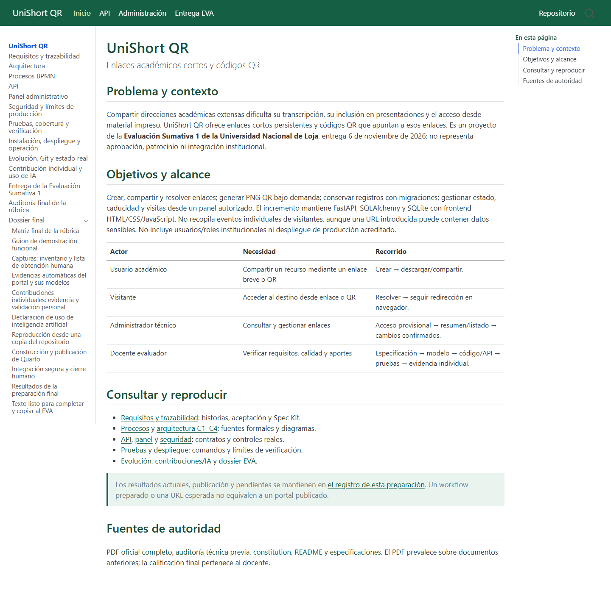
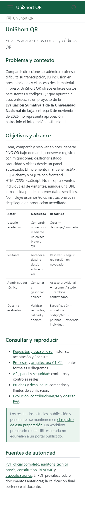

# Evidencias automáticas del portal y sus modelos

Estas imágenes se obtuvieron con Chromium/Playwright durante la comprobación local
de la documentación. Son capturas reales del HTML/SVG generado; **no** acreditan
una demostración humana del producto, aceptación estudiantil ni publicación Pages.

| Archivo | Qué documenta |
|---|---|
| [Inicio escritorio](evidencias-automaticas/portal-escritorio.png) | Portal renderizado a 1440×1000; captura de página completa. |
| [Inicio móvil](evidencias-automaticas/portal-movil.png) | Portal a 390×844; captura completa, sin desbordamiento horizontal del inicio. |
| [BPMN creación](evidencias-automaticas/bpmn-creacion.png) | Rasterización del SVG exportado del XML formal. |
| [C4/UML código](evidencias-automaticas/uml-codigo.png) | Módulos/clases y relaciones renderizados desde PlantUML. |
| [C1 contexto](evidencias-automaticas/C1-Contexto.png), [C2 contenedores](evidencias-automaticas/C2-Contenedores.png), [C3 componentes](evidencias-automaticas/C3-Componentes-backend.png) | Vistas exportadas del DSL Structurizr, con acentos UTF-8. |
| [BPMN QR](evidencias-automaticas/bpmn-Diagram_QR.png), [redirección](evidencias-automaticas/bpmn-Diagram_Redirect.png), [administración](evidencias-automaticas/bpmn-Diagram_Admin.png) | Las otras tres vistas formales del XML. |
| [Resultado JSON](evidencias-automaticas/resultado-portal.json) | Fecha UTC real, versión Chromium, páginas/diagramas y errores detectados. |

## Vista previa



{width=280}

## Reproducción

Después de construir el sitio y configurar PLAYWRIGHT_BROWSERS_PATH según la guía:

```powershell
node tools/documentation/check-portal.mjs
```

El script sirve únicamente quarto/_site en loopback con puerto aleatorio, abre un
navegador headless independiente, comprueba páginas/imágenes/Mermaid, obtiene
capturas y cierra sus propios recursos. No abre cuentas, aplicaciones de usuario
ni bases del producto. Los tiempos se guardan en UTC; convertir a America/Guayaquil
al citar el día local (UTC−5). No alterar fechas para aparentar otra ejecución.

Los SVG completos y el manifiesto de hashes están en el portal, secciones Procesos
y Arquitectura. La [lista de capturas humanas pendientes](evidencias-capturas.md)
se mantiene separada. La inspección automática no es una auditoría WCAG completa.
