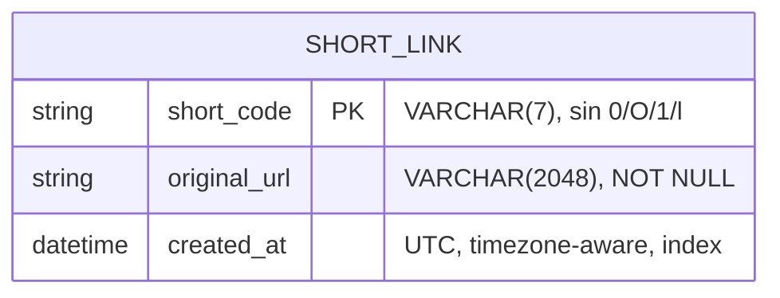

# Data Model: Crear enlaces cortos (Feature 1)

**Date**: 2026-10-21 | **Plan**: [plan.md](./plan.md) | **Spec**: [spec.md](./spec.md)

Modelo de datos de la iteración actual. Una sola entidad persistente, sin datos
de la persona que crea el enlace. El motor de datos implementado en esta
fase es **SQLite**; la portabilidad hacia **PostgreSQL** (decisión de
despliegue registrada en [research.md](./research.md) R-11) se garantiza por
las reglas de la sección *Portabilidad*, sin añadir dependencias ni código
específico de PostgreSQL en esta fase.

## Entidad: `short_link`

Relación única entre un código corto y una URL original (Key Entities del
spec). No existen entidades de visitante, estadísticas ni códigos QR.

| Campo | Tipo SQLAlchemy | Columna | Restricción | Descripción |
|-------|-----------------|---------|-------------|-------------|
| `short_code` | `String(7)` | `short_code` | `PRIMARY KEY` | Código corto de 7 caracteres del alfabeto `abcdefghijkmnpqrstuvwxyz23456789`, en minúsculas. |
| `original_url` | `String(2048)` | `original_url` | `NOT NULL` | URL de destino aceptada, almacenada completa e inmodificada. |
| `created_at` | `DateTime(timezone=True)` | `created_at` | `NOT NULL`, índice | Marca de creación en UTC consciente de zona horaria, generada por la aplicación. |

Índice: `ix_short_links_created_at` sobre `created_at` (exigido por la
constitución junto con el índice del código corto, que es la propia clave
primaria). El índice sobre la fecha de vencimiento queda fuera de esta
iteración: ver *Complexity Tracking* en [plan.md](./plan.md).



## Invariantes

1. **Unicidad global del código corto**, garantizada por la restricción de
   base de datos (clave primaria), no solo por lógica de aplicación
   (constitución > Modelo de Datos y Persistencia).
2. **Sin deduplicación**: la misma `original_url` puede aparecer en varias
   filas con códigos distintos (supuesto del spec y R-08 de
   [research.md](./research.md)). Por eso no existe índice único ni
   secundario sobre `original_url`.
3. `created_at` se calcula en la aplicación con `datetime.now(timezone.utc)`
   para que el valor sea igual de consciente de zona en SQLite y en
   PostgreSQL.
4. La URL se almacena una sola vez, tal y fue aceptada. La única
   normalización permitida es eliminar los espacios del principio y del final
   antes de validar; una vez aceptada, no se recorta ni se reescribe.
5. Ningún campo identifica a la persona que crea el enlace: no hay IP, nombre,
   correo, cookie, identificador de sesión ni agente de usuario (FR-008,
   SC-008).

## Validación y persistencia por regla

| Regla del spec | Capa | Resultado al fallar |
|----------------|------|---------------------|
| Cadena no vacía ni compuesta solo por espacios | Frontera Pydantic (`api/schemas.py`) | 422 `invalid_payload` |
| Sin espacios internos | Frontera Pydantic (`api/schemas.py`) | 422 `invalid_payload` |
| Longitud ≤ 2.048 caracteres | Frontera Pydantic (`api/schemas.py`) | 422 `url_too_long` |
| Campos desconocidos en el cuerpo | Frontera Pydantic (`api/schemas.py`, `extra="forbid"`) | 422 `invalid_payload` |
| Esquema `http` o `https`, URL absoluta | Dominio (`domain/url.py`) | 400 `invalid_scheme` |
| Host no vacío y bien formado | Dominio (`domain/url.py`) | 400 `invalid_host` |
| Sin credenciales embebidas | Dominio (`domain/url.py`) | 400 `embedded_credentials` |
| Código corto único | Persistencia (`persistence/repository.py`) + restricción de BD | Reintento con código nuevo; 409 `collision_unresolved` si se agotan |
| Guardado completo | Servicio (`services/shorten.py`) | 500 `persistence_failure`, con reversión de la transacción |

El contrato completo, con ejemplos y localización, está en
[contracts/shorten.md](./contracts/shorten.md) y
[contracts/errors.md](./contracts/errors.md).

## Migración inicial (Alembic)

Migración reversible creada con `alembic revision --autogenerate` contra un
esquema vacío y corregida a mano. Solo usa constructos portables de
SQLAlchemy: no aparece SQL específico de SQLite ni de PostgreSQL.

```python
def upgrade() -> None:
    op.create_table(
        "short_links",
        sa.Column("short_code", sa.String(length=7), nullable=False),
        sa.Column("original_url", sa.String(length=2048), nullable=False),
        sa.Column("created_at", sa.DateTime(timezone=True), nullable=False),
        sa.PrimaryKeyConstraint("short_code", name="pk_short_links"),
        sa.Index("ix_short_links_created_at", "created_at"),
    )


def downgrade() -> None:
    op.drop_table("short_links")
```

Se aplica con el único comando documentado `alembic upgrade head`. El arranque
de la aplicación no modifica el esquema. Solo las pruebas crean el esquema por
metadatos, sobre su base SQLite en memoria aislada.

## Portabilidad SQLite → PostgreSQL

Decisión registrada en [research.md](./research.md) R-11 y en
`docs/adr/0002-motor-de-datos-y-despliegue.md`: SQLite es el motor de esta
fase (desarrollo y pruebas) y PostgreSQL será el motor de producción. La capa
de persistencia no depende de SQLite, de modo que el cambio de motor no
requiere reescribir el dominio. Reglas que se respetan desde ya:

1. **Solo tipos portables** de SQLAlchemy: `String`, `DateTime(timezone=True)`,
   claves e índices declarativos. Sin `AUTOINCREMENT`, sin funciones propias
   de SQLite, sin `JSON` ni enumeraciones específicas de un motor.
2. **Sin SQL en crudo** en el código de aplicación: toda consulta pasa por el
   ORM o por constructos declarativos.
3. **Convención de nombres** fijada en los metadatos
   (`pk_short_links`, `ix_short_links_created_at`) para que Alembic pueda
   generar y revertir migraciones igual en ambos motores.
4. **El motor se elige por configuración**, con la variable de entorno
   `UNISHORT_DATABASE_URL` (por defecto `sqlite:///./unishort.db`). En
   producción se apuntará a PostgreSQL sin tocar código.
5. **Las pruebas usan SQLite**, como exige la constitución. Por eso la
   portabilidad se sostiene en estas reglas de diseño y no en una suite
   paralela contra PostgreSQL.

Quedan diferidos fuera de esta fase, y sin complejidad añadida ahora: el
cliente de PostgreSQL (`psycopg`), el contenedor de despliegue y la enmienda
de la constitución que retire el marcador de destino de despliegue.

## Capacidad y rendimiento

Con un millón de filas, la clave primaria de 7 caracteres mantiene la
búsqueda por código en un solo índice, y el índice de `created_at` soporta
consultas temporales sin variar el modelo (constitución > Rendimiento y
Escalabilidad). La URL máxima de 2.048 caracteres fija el peor caso de
almacenamiento; el caso típico lo reduce de forma considerable.

## Fuera de alcance de esta iteración

- `expires_at` y cualquier estado de vencimiento: la expiración no es alcance
  de la Feature 1; el índice correspondiente se creará junto con el campo, en
  la misma migración (ver *Complexity Tracking* de [plan.md](./plan.md)).
- Datos de visitantes, contadores de clics o métricas: no existen columnas
  para ellos y no se crearán en esta especificación.
